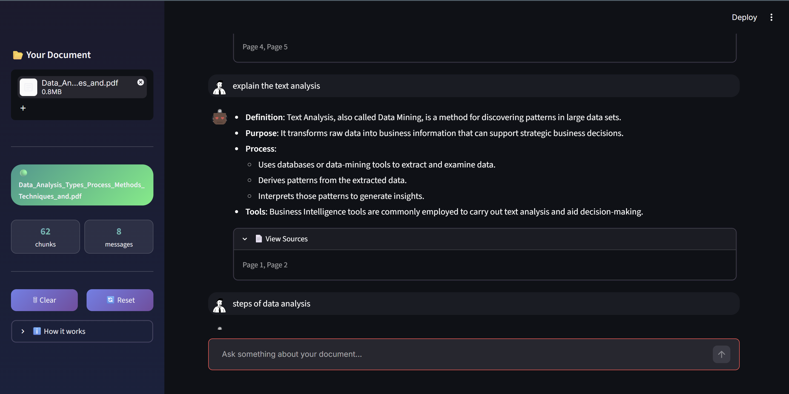
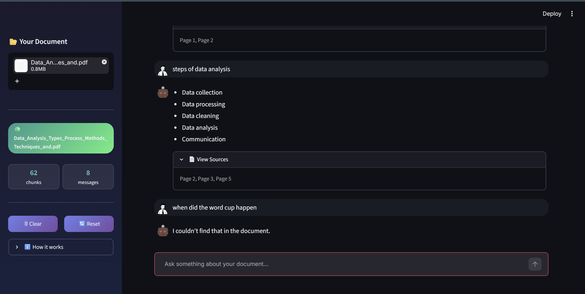
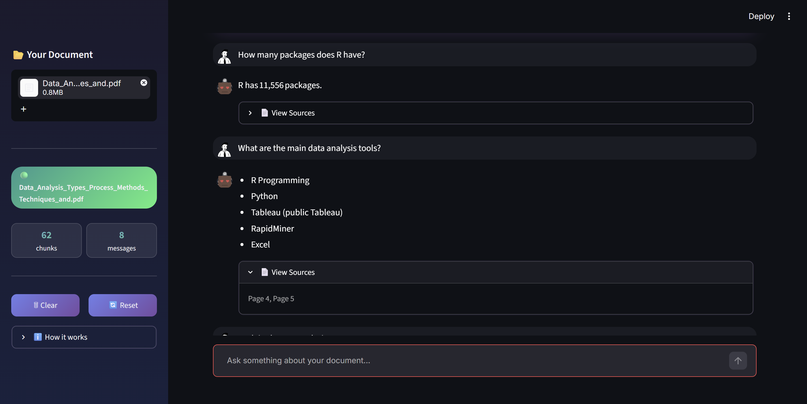

# DocMind AI – RAG-Based Document Assistant

DocMind AI is a Retrieval-Augmented Generation (RAG) application that lets users upload a PDF and ask natural language questions about it. It retrieves the most relevant sections using semantic search and answers only from the document, with page citations. If the answer isn't in the document, it says so instead of guessing.

## Live Demo

https://rag-document-assistant-z84rv6u7qzbug4dyxfmvjy.streamlit.app/

## GitHub Repository

https://github.com/Sathvikha-715/rag-document-assistant

---

## Screenshots

### Grounded answer with page citations


### Refuses questions the document can't answer


### List question across several pages


---

## Features

- Upload and process any PDF (a fresh index is built per file, so documents never get mixed up)
- Semantic search using vector embeddings
- Context-aware question answering grounded in the document
- Source page citations chosen by matching the generated answer back to the document
- Refuses out-of-document questions instead of guessing
- Broader retrieval for summary and list-style questions
- Handles empty model responses with an automatic retry
- OCR fallback for scanned PDFs (local runs)
- Interactive Streamlit interface with chat history

---

## Tech Stack

- Python
- Streamlit
- LangChain
- Groq (gpt-oss-120b)
- HuggingFace Embeddings (all-MiniLM-L6-v2)
- ChromaDB
- PyMuPDF (with EasyOCR fallback for scanned PDFs)

---

## How It Works

1. Upload a PDF document.
2. Extract the text (OCR is used if the PDF is scanned) and split it into chunks.
3. Generate embeddings and store them in a fresh ChromaDB collection.
4. Retrieve the most relevant chunks for the user's question.
5. Generate an answer using only those chunks.
6. Display the answer with source page citations, or a refusal if the document has no answer.

---

## Evaluation

Tested on a 24-question set built from one 6-page research paper (22 document questions and 2 off-topic questions that should be refused).

| Metric | Result |
|---|---|
| Answer accuracy | 24/24 |
| Page-citation hit | 21/21 |
| Average response time | 6.1 s |

**Limitations**

- Answers are scored by keyword matching, so this is a quick check, not a full RAG evaluation.
- Only one document was tested. I tuned retrieval and citations after finding failures (for example, a "list all tools" question that first missed items), so the score is a best case.
- Questions that need every item from a long section can still miss items.
- Page numbers refer to PDF page order, not the printed page numbers.
- Response time depends on the Groq model and the amount of text retrieved.

---

## Installation

```bash
git clone https://github.com/Sathvikha-715/rag-document-assistant.git
cd rag-document-assistant

python -m venv venv

# Windows
venv\Scripts\activate

# Git Bash
source venv/Scripts/activate

pip install -r requirements.txt
```

Create a `.env` file:

```env
GROQ_API_KEY=your_api_key_here
GROQ_MODEL=openai/gpt-oss-120b
```

Run the application:

```bash
streamlit run app.py
```

**Optional: scanned PDFs.** Install OCR support locally with `pip install easyocr`. It is left out of the deployed version because it is large.

---

## Run the Evaluation

1. Put a PDF in the project folder.
2. Set `PDF_PATH` in `test_eval.py` to that file. The questions are written for a data analysis paper, so edit them for a different PDF.
3. Run `python test_eval.py`.

---

## Project Structure

```text
rag-document-assistant/
│
├── app.py             # Streamlit interface
├── src/
│   ├── loader.py      # PDF text extraction + OCR fallback
│   ├── splitter.py    # Chunking
│   ├── vectorstore.py # Embeddings + ChromaDB
│   ├── prompts.py     # Answer rules
│   └── rag_chain.py   # Retrieval, answer generation, citations
├── screenshots/       # README images
├── test_eval.py       # Evaluation script
├── requirements.txt
└── README.md
```

---

## Future Improvements

- Hybrid search (keyword + vector) and reranking
- Evaluation with RAGAS
- Conversation memory for follow-up questions
- Querying several PDFs at once
- Docker containerization

---

## Author

**Sathvikha Reddy**

B.E. – Artificial Intelligence and Data Science

GitHub: https://github.com/Sathvikha-715